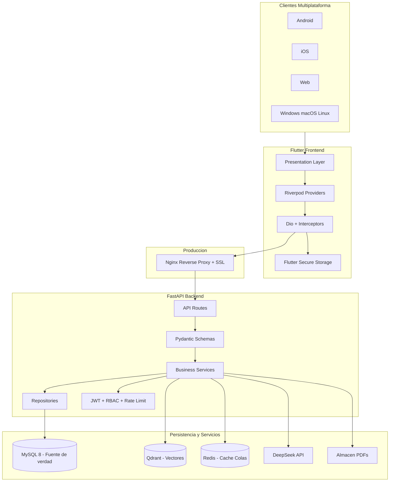
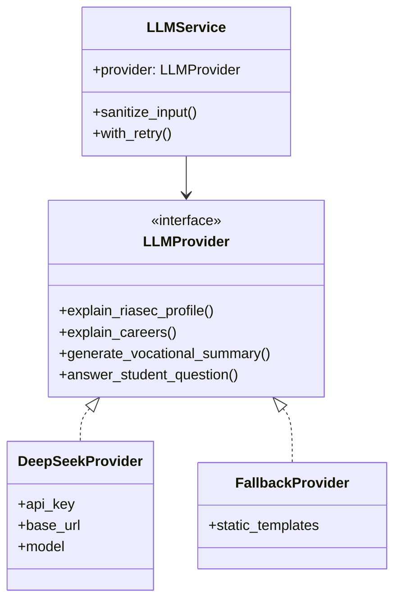
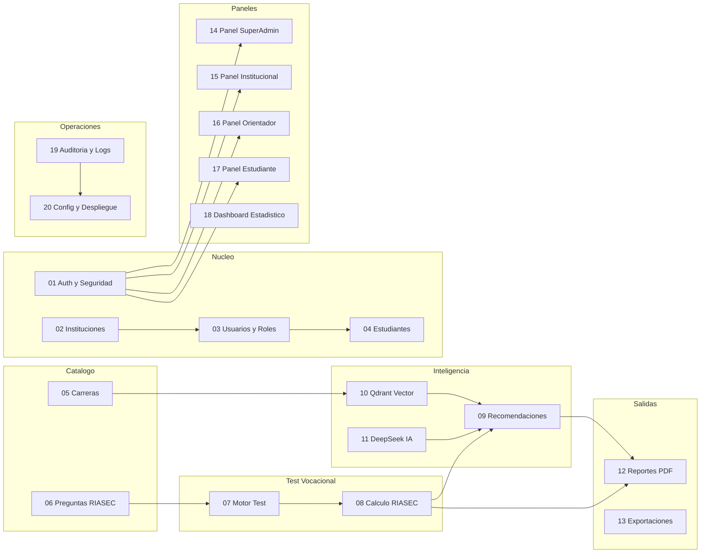

# Arquitectura AVOV

**Versión:** Fase 0 — Análisis inicial  
**Proyecto:** AVOV — Asistente Virtual de Orientación Vocacional con IA  
**Workspace:** `aplicstibi/` (monorepo raíz)

---

## 1. Visión general

AVOV es una plataforma multiplataforma de orientación vocacional para estudiantes de bachillerato. Combina el modelo RIASEC, búsqueda semántica con Qdrant, explicaciones con IA (DeepSeek) y reportes PDF institucionales.

### Stack tecnológico

| Capa | Tecnología |
|------|------------|
| Frontend | Flutter, Dart, Riverpod, GoRouter, Dio, Flutter Secure Storage |
| Backend | Python, FastAPI, SQLAlchemy, Alembic, Pydantic, JWT, Bcrypt |
| Base de datos | MySQL 8, phpMyAdmin (solo desarrollo) |
| Motor vectorial | Qdrant |
| Caché / colas | Redis |
| IA | DeepSeek API (adaptador intercambiable) |
| PDF | ReportLab o WeasyPrint |
| Infraestructura | Docker, Docker Compose, Nginx, `.env` |

### Plataformas soportadas

- Android
- iOS
- Web
- Escritorio (Windows, macOS, Linux — estructura base en Flutter; builds validados en Fase 31)

---

## 2. Diagrama de capas



---

## 3. Principios arquitectónicos obligatorios

### 3.1 Regla MySQL > Qdrant

**MySQL es la fuente de verdad transaccional.** Qdrant almacena datos derivados (embeddings) para búsqueda semántica. Si existe conflicto entre ambos, **gana MySQL**. Los vectores pueden reconstruirse desde MySQL mediante `POST /api/v1/vector/rebuild-careers`.

### 3.2 Capas estrictas en backend

```
routes → schemas → services → repositories → models
```

- Los endpoints **no** contienen lógica de negocio.
- Los servicios **no** acceden directamente a HTTP.
- Los repositorios encapsulan consultas SQLAlchemy.

### 3.3 Feature-first en Flutter

Cada módulo en `lib/features/<modulo>/` sigue:

```
data/       → datasources, repositories, DTOs
domain/     → entidades, contratos
presentation/ → screens, widgets, providers
```

### 3.4 IA solo en backend

- DeepSeek se llama exclusivamente desde FastAPI.
- Flutter nunca accede a API keys de IA.
- Adaptador `LLMProvider` permite cambiar de proveedor sin modificar servicios de negocio.

### 3.5 Seguridad por defecto

- JWT con refresh token revocable.
- RBAC en middleware y servicios.
- Validación backend obligatoria (no confiar solo en frontend).
- Rate limiting en login (Redis).
- Auditoría de acciones críticas.
- Sin secretos en cliente ni en repositorio.

### 3.6 Respuesta JSON estándar

```json
{
  "success": true,
  "message": "Operación realizada correctamente",
  "data": {},
  "errors": []
}
```

Implementado en `backend/app/core/responses.py`.

---

## 4. Adaptador de IA (cambio de proveedor)



**Prompt de sistema obligatorio:**

> El asistente debe orientar vocacionalmente al estudiante de forma clara, educativa, ética y no determinista. Debe explicar que las recomendaciones son apoyo y no reemplazan la orientación profesional de un psicólogo u orientador educativo.

**Fallback:** Si DeepSeek falla, el sistema responde con plantillas estáticas sin interrumpir el flujo del test.

---

## 5. Diagrama de módulos (20 módulos)



### Dependencias críticas

| Módulo | Depende de |
|--------|------------|
| Todos los protegidos | Auth (M01) |
| Test vocacional (M07) | Preguntas RIASEC (M06), Estudiantes (M04) |
| Recomendaciones (M09) | RIASEC (M08), Carreras (M05), Qdrant (M10), IA (M11) |
| PDF (M12) | Test completado, Recomendaciones, Observaciones orientador |

---

## 6. Flujo de datos

```
Flutter → FastAPI → MySQL   (datos transaccionales)
                 → Qdrant   (búsqueda semántica)
                 → Redis    (caché / rate limit / sesiones)
                 → DeepSeek (orientación IA)
                 → Storage  (PDFs generados)
```

---

## 7. Roles del sistema

| Rol | Código | Alcance |
|-----|--------|---------|
| Super Administrador | `SUPER_ADMIN` | Gestión global: instituciones, usuarios, estadísticas, configuración, auditoría |
| Administrador Institucional | `INSTITUTION_ADMIN` | Solo su institución: estudiantes, orientadores, reportes |
| Orientador / Psicólogo | `COUNSELOR` | Estudiantes asignados: resultados, observaciones, PDF |
| Estudiante | `STUDENT` | Solo su información: perfil, test, resultados, asistente, PDF |

---

## 8. Estado actual del workspace

| Área | Estado (post Fase 0) |
|------|----------------------|
| Monorepo base | Parcialmente creado |
| Docker Compose | MySQL, phpMyAdmin, Redis, Qdrant, backend definidos |
| Backend FastAPI | Health check + respuestas estándar |
| Frontend Flutter | Splash, home, Dio, GoRouter, Riverpod |
| Base de datos | Init SQL; migraciones de negocio pendientes (Fase 4) |
| Documentación Fase 0 | Completa en `docs/` |

**Decisión:** Mantener monorepo en `aplicstibi/`. El alias `avov-platform/` de las reglas Cursor mapea a la raíz actual.

---

## 9. Documentación relacionada

- [Estructura del proyecto](estructura-proyecto.md)
- [Modelo de base de datos](modelo-base-datos.md)
- [API Endpoints](api-endpoints.md)
- [Pantallas Flutter](pantallas-flutter.md)
- [Flujos del sistema](flujos.md)
- [Plan de desarrollo (32 fases)](plan-desarrollo.md)
- [Criterios de validación Fase 0](criterios-validacion-fase0.md)
