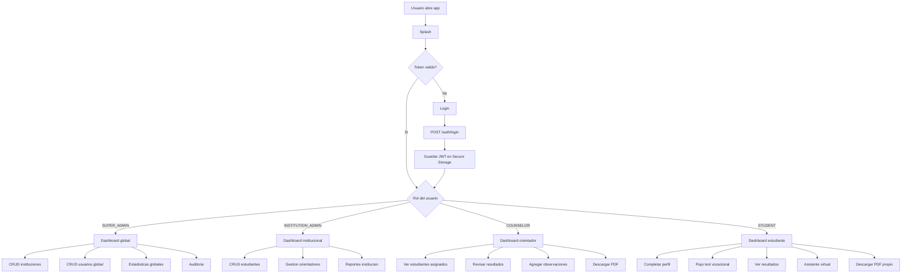
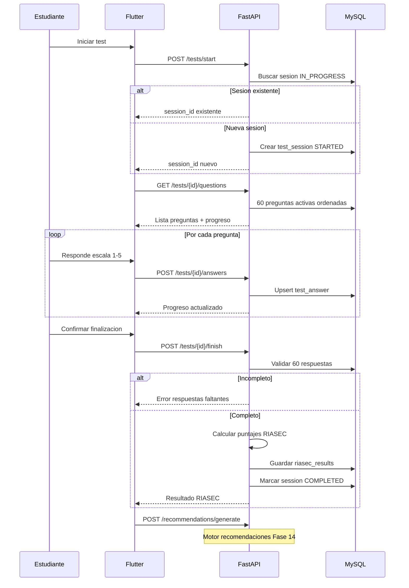
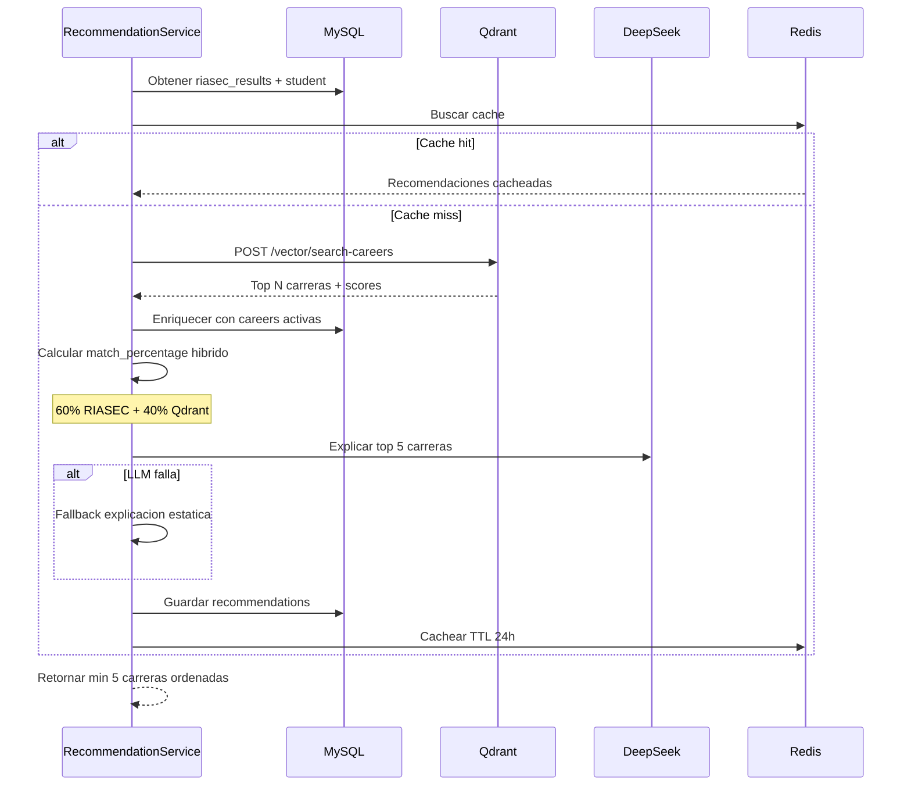
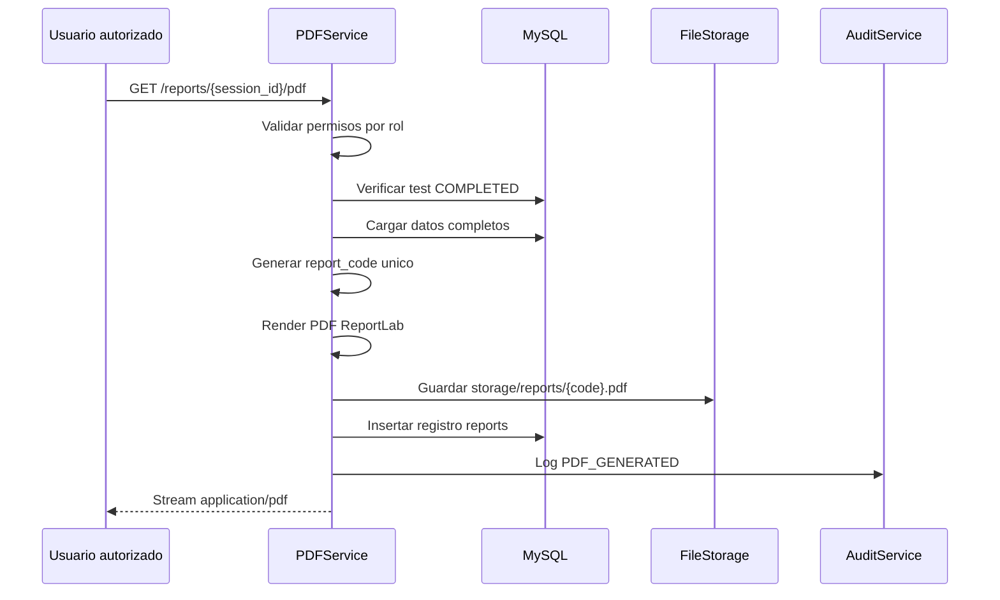
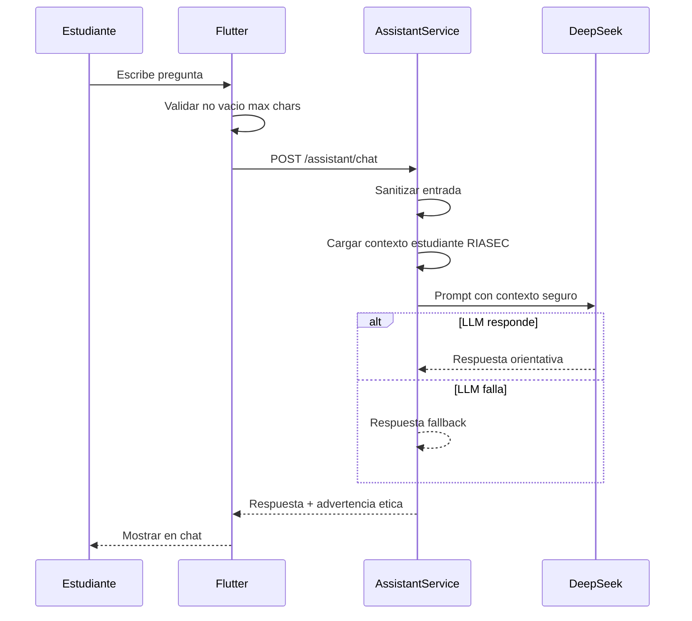
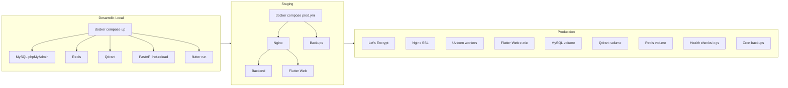

# Flujos del sistema — AVOV

**Fase:** 0 — Análisis de flujos críticos

---

## 1. Flujo de usuario por rol



### Reglas de navegación

- Rutas públicas: `/`, `/login`
- Rutas protegidas: `auth_guard` verifica JWT válido
- Rutas por rol: `role_guard` verifica permisos
- Estudiante **no** accede a `/admin/*` ni `/institution/*`
- Orientador solo ve estudiantes en `counselor_assignments`
- INSTITUTION_ADMIN solo ve datos de su `institution_id`

---

## 2. Flujo del test vocacional RIASEC



### Algoritmo de cálculo RIASEC

1. Sumar `answer_value` (1-5) por categoría — 10 preguntas × 6 categorías.
2. Puntaje máximo por categoría: **50**. Mínimo: **10**.
3. `dominant_profile`: categoría con mayor puntaje.
4. Desempate: orden de prioridad **R > I > A > S > E > C**.
5. `secondary_profile`: segunda categoría más alta.
6. Perfil combinado: dominante + secundaria + tercera (ej. ISA, SEC, RIA).
7. Guardar en `riasec_results`; IA enriquece `interpretation` después.

### Escala de respuesta

| Valor | Significado |
|-------|-------------|
| 1 | No me gusta nada |
| 2 | Me gusta poco |
| 3 | Me es indiferente |
| 4 | Me gusta |
| 5 | Me gusta mucho |

### Reglas de negocio

- Un estudiante con test `IN_PROGRESS` continúa el mismo test.
- No puede finalizar sin las 60 respuestas.
- No puede modificar test `COMPLETED` sin permiso especial.
- No puede responder preguntas de otra sesión.
- `answer_value` siempre entre 1 y 5.

---

## 3. Flujo de recomendación (RIASEC + Qdrant + IA)



### Fórmula de compatibilidad híbrida

```
match_percentage = (riasec_score * 0.60) + (qdrant_score * 0.40)
```

- `riasec_score`: coincidencia de letras del perfil dominante/secundario con `career.riasec_profile`.
- `qdrant_score`: score de similitud vectorial normalizado a 0-100.

### Fallback sin Qdrant

Filtrar carreras MySQL activas cuyo `riasec_profile` contenga letras del perfil dominante del estudiante. Ordenar por coincidencia de letras.

### Reglas

- Mínimo **5 carreras** recomendadas.
- Solo carreras con `status = ACTIVE`.
- Sin duplicados por sesión (`UNIQUE test_session_id + career_id`).
- `match_percentage` entre 0 y 100.
- Orientador puede agregar observaciones en `counselor_observations`.

---

## 4. Flujo de generación PDF



### Contenido obligatorio del PDF

1. Logo y datos de la institución
2. Datos del estudiante (sin datos sensibles)
3. Fecha del test y código único del reporte
4. Perfil RIASEC dominante y secundario
5. Puntajes por categoría (gráfico o tabla)
6. Top 5+ carreras recomendadas con compatibilidad
7. Explicación IA (o fallback estático)
8. Observación del orientador (si existe)
9. Nota ética obligatoria
10. Datos del responsable / generador

### Seguridad PDF

- Solo usuarios autorizados por rol y ownership
- Test debe estar `COMPLETED`
- Almacenamiento fuera de webroot (`storage/reports/`)
- Sin path traversal en `file_path`
- Registro en `reports` y `audit_logs`
- Auditoría de descarga

---

## 5. Flujo del asistente virtual (chat)



### Restricciones del asistente

- No enviar datos sensibles innecesarios a DeepSeek
- Incluir advertencia ética en cada respuesta
- Límite de caracteres por mensaje
- Rate limiting por estudiante (Redis)
- Flutter **nunca** llama DeepSeek directamente

---

## 6. Flujo de despliegue



### Servicios Docker producción (Fase 31)

| Servicio | Configuración |
|----------|---------------|
| nginx | Proxy `/api` → backend, `/` → Flutter web, SSL |
| backend | Imagen optimizada, sin volumen de código |
| mysql | Volumen persistente, backups cron |
| redis | Volumen persistente |
| qdrant | Volumen persistente, backups documentados |
| phpmyadmin | **NO expuesto** en producción |

### Health checks

- Backend: `GET /api/v1/health`
- MySQL: `mysqladmin ping`
- Redis: `redis-cli ping`
- Qdrant: `GET /healthz`
