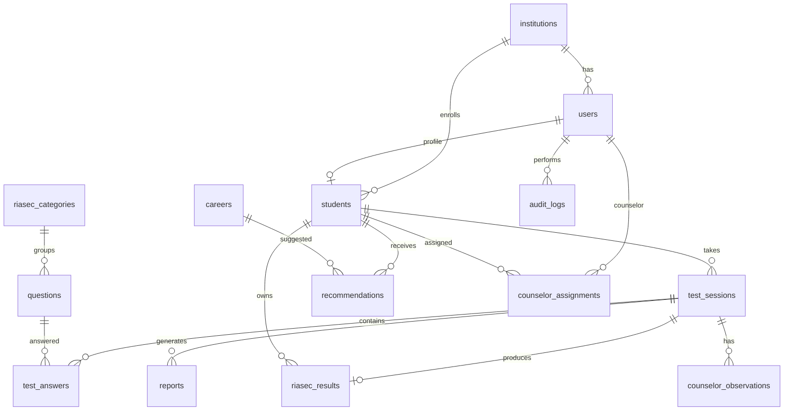

# Modelo de base de datos — AVOV

**Fase:** 0 — Diseño aprobado (implementación en Fase 4 con Alembic)  
**Motor:** MySQL 8  
**ORM:** SQLAlchemy 2.x

---

## Convenciones generales

- Todas las tablas incluyen: `id` (BIGINT PK AUTO_INCREMENT), `created_at`, `updated_at`.
- Eliminación lógica mediante `status` (no DELETE físico en registros auditables).
- Foreign keys con `ON DELETE RESTRICT` salvo tokens temporales.
- Índices en campos de búsqueda frecuente y restricciones UNIQUE donde aplique.
- Enums centralizados en `backend/app/core/enums.py`.

---

## Enums del sistema

| Enum | Valores |
|------|---------|
| `UserRole` | SUPER_ADMIN, INSTITUTION_ADMIN, COUNSELOR, STUDENT |
| `UserStatus` | ACTIVE, INACTIVE, BLOCKED |
| `InstitutionStatus` | ACTIVE, INACTIVE |
| `QuestionStatus` | ACTIVE, INACTIVE |
| `TestSessionStatus` | STARTED, IN_PROGRESS, COMPLETED, CANCELLED |
| `Gender` | MALE, FEMALE, OTHER, NOT_SPECIFIED |
| `DegreeType` | TECNOLOGICO, TERCER_NIVEL, LICENCIATURA, INGENIERIA, OTRO |
| `InstitutionType` | PUBLICA, PRIVADA, AMBAS |
| `CareerStatus` | ACTIVE, INACTIVE |

---

## Diagrama entidad-relación



---

## Tablas obligatorias

### `institutions`

| Campo | Tipo | Restricciones |
|-------|------|---------------|
| id | BIGINT | PK |
| name | VARCHAR(150) | NOT NULL, min 3 chars |
| code | VARCHAR(50) | NOT NULL, UNIQUE |
| province | VARCHAR(100) | NOT NULL |
| city | VARCHAR(100) | NOT NULL |
| address | VARCHAR(255) | NULL |
| phone | VARCHAR(15) | Solo números, 7-15 dígitos |
| email | VARCHAR(255) | Formato email válido |
| logo_url | VARCHAR(500) | NULL |
| status | ENUM | ACTIVE, INACTIVE |
| created_at | DATETIME | NOT NULL |
| updated_at | DATETIME | NOT NULL |

**Índices:** UNIQUE(`code`), INDEX(`status`), INDEX(`province`, `city`)

---

### `users`

| Campo | Tipo | Restricciones |
|-------|------|---------------|
| id | BIGINT | PK |
| institution_id | BIGINT | FK → institutions, NULL si SUPER_ADMIN |
| first_name | VARCHAR(100) | NOT NULL |
| last_name | VARCHAR(100) | NOT NULL |
| email | VARCHAR(255) | NOT NULL, UNIQUE |
| password_hash | VARCHAR(255) | NOT NULL (bcrypt) |
| role | ENUM | SUPER_ADMIN, INSTITUTION_ADMIN, COUNSELOR, STUDENT |
| phone | VARCHAR(15) | NULL, formato válido |
| avatar_url | VARCHAR(500) | NULL |
| status | ENUM | ACTIVE, INACTIVE, BLOCKED |
| last_login_at | DATETIME | NULL |
| created_at | DATETIME | NOT NULL |
| updated_at | DATETIME | NOT NULL |

**Índices:** UNIQUE(`email`), INDEX(`institution_id`), INDEX(`role`), INDEX(`status`)

**Validación contraseña (al crear/cambiar):** mínimo 8 caracteres, 1 mayúscula, 1 minúscula, 1 número, 1 símbolo.

---

### `students`

| Campo | Tipo | Restricciones |
|-------|------|---------------|
| id | BIGINT | PK |
| user_id | BIGINT | FK → users, UNIQUE |
| institution_id | BIGINT | FK → institutions |
| identification | VARCHAR(50) | NOT NULL, UNIQUE |
| birth_date | DATE | NOT NULL, no futura |
| gender | ENUM | MALE, FEMALE, OTHER, NOT_SPECIFIED |
| grade | VARCHAR(20) | NOT NULL |
| parallel | VARCHAR(10) | NULL |
| representative_name | VARCHAR(150) | NULL |
| representative_phone | VARCHAR(15) | NULL, válido si existe |
| representative_email | VARCHAR(255) | NULL, válido si existe |
| created_at | DATETIME | NOT NULL |
| updated_at | DATETIME | NOT NULL |

**Índices:** UNIQUE(`identification`), UNIQUE(`user_id`), INDEX(`institution_id`)

---

### `riasec_categories`

| Campo | Tipo | Restricciones |
|-------|------|---------------|
| id | BIGINT | PK |
| code | CHAR(1) | NOT NULL, UNIQUE (R,I,A,S,E,C) |
| name | VARCHAR(50) | NOT NULL |
| description | TEXT | NULL |
| created_at | DATETIME | NOT NULL |
| updated_at | DATETIME | NOT NULL |

**Datos seed:** R Realista, I Investigador, A Artístico, S Social, E Emprendedor, C Convencional.

---

### `questions`

| Campo | Tipo | Restricciones |
|-------|------|---------------|
| id | BIGINT | PK |
| category_id | BIGINT | FK → riasec_categories |
| text | TEXT | NOT NULL |
| order_number | INT | NOT NULL |
| status | ENUM | ACTIVE, INACTIVE |
| created_at | DATETIME | NOT NULL |
| updated_at | DATETIME | NOT NULL |

**Índices:** UNIQUE(`category_id`, `order_number`), INDEX(`status`)

**Seed:** 60 preguntas (10 por categoría), escala de respuesta 1-5 definida en aplicación.

---

### `test_sessions`

| Campo | Tipo | Restricciones |
|-------|------|---------------|
| id | BIGINT | PK |
| student_id | BIGINT | FK → students |
| status | ENUM | STARTED, IN_PROGRESS, COMPLETED, CANCELLED |
| started_at | DATETIME | NOT NULL |
| finished_at | DATETIME | NULL |
| total_questions | INT | NOT NULL, default 60 |
| current_question | INT | NOT NULL, default 1 |
| created_at | DATETIME | NOT NULL |
| updated_at | DATETIME | NOT NULL |

**Índices:** INDEX(`student_id`, `status`)

---

### `test_answers`

| Campo | Tipo | Restricciones |
|-------|------|---------------|
| id | BIGINT | PK |
| test_session_id | BIGINT | FK → test_sessions |
| question_id | BIGINT | FK → questions |
| answer_value | TINYINT | NOT NULL, CHECK 1-5 |
| created_at | DATETIME | NOT NULL |
| updated_at | DATETIME | NOT NULL |

**Índices:** UNIQUE(`test_session_id`, `question_id`)

---

### `riasec_results`

| Campo | Tipo | Restricciones |
|-------|------|---------------|
| id | BIGINT | PK |
| test_session_id | BIGINT | FK → test_sessions, UNIQUE |
| student_id | BIGINT | FK → students |
| score_r | INT | NOT NULL, >= 0 |
| score_i | INT | NOT NULL, >= 0 |
| score_a | INT | NOT NULL, >= 0 |
| score_s | INT | NOT NULL, >= 0 |
| score_e | INT | NOT NULL, >= 0 |
| score_c | INT | NOT NULL, >= 0 |
| dominant_profile | CHAR(1) | NOT NULL al completar |
| secondary_profile | CHAR(1) | NOT NULL al completar |
| interpretation | TEXT | NULL (IA enriquece) |
| created_at | DATETIME | NOT NULL |
| updated_at | DATETIME | NOT NULL |

**Algoritmo:** Suma de respuestas por categoría (max 50, min 10). Desempate: R > I > A > S > E > C.

---

### `careers`

| Campo | Tipo | Restricciones |
|-------|------|---------------|
| id | BIGINT | PK |
| name | VARCHAR(200) | NOT NULL |
| area | VARCHAR(100) | NOT NULL |
| description | TEXT | NOT NULL |
| riasec_profile | VARCHAR(10) | NOT NULL |
| duration | VARCHAR(50) | NULL |
| degree_type | ENUM | TECNOLOGICO, TERCER_NIVEL, LICENCIATURA, INGENIERIA, OTRO |
| institution_type | ENUM | PUBLICA, PRIVADA, AMBAS |
| employment_field | VARCHAR(200) | NOT NULL |
| status | ENUM | ACTIVE, INACTIVE |
| created_at | DATETIME | NOT NULL |
| updated_at | DATETIME | NOT NULL |

**Índices:** INDEX(`riasec_profile`), INDEX(`area`), INDEX(`status`), INDEX(`degree_type`)

---

### `recommendations`

| Campo | Tipo | Restricciones |
|-------|------|---------------|
| id | BIGINT | PK |
| student_id | BIGINT | FK → students |
| test_session_id | BIGINT | FK → test_sessions |
| career_id | BIGINT | FK → careers |
| match_percentage | DECIMAL(5,2) | NOT NULL, 0-100 |
| ai_explanation | TEXT | NULL |
| qdrant_score | FLOAT | NULL |
| created_at | DATETIME | NOT NULL |
| updated_at | DATETIME | NOT NULL |

**Índices:** UNIQUE(`test_session_id`, `career_id`), INDEX(`student_id`)

---

### `reports`

| Campo | Tipo | Restricciones |
|-------|------|---------------|
| id | BIGINT | PK |
| student_id | BIGINT | FK → students |
| test_session_id | BIGINT | FK → test_sessions |
| file_path | VARCHAR(500) | NOT NULL |
| report_code | VARCHAR(50) | NOT NULL, UNIQUE |
| generated_by | BIGINT | FK → users |
| created_at | DATETIME | NOT NULL |
| updated_at | DATETIME | NOT NULL |

---

### `audit_logs`

| Campo | Tipo | Restricciones |
|-------|------|---------------|
| id | BIGINT | PK |
| user_id | BIGINT | FK → users, NULL |
| action | VARCHAR(100) | NOT NULL |
| entity | VARCHAR(100) | NOT NULL |
| entity_id | BIGINT | NULL |
| ip_address | VARCHAR(45) | NULL |
| user_agent | VARCHAR(500) | NULL |
| details | JSON | NULL |
| created_at | DATETIME | NOT NULL |

**Índices:** INDEX(`user_id`), INDEX(`action`), INDEX(`entity`, `entity_id`), INDEX(`created_at`)

**Prohibido registrar:** contraseñas, tokens, API keys.

---

## Tablas complementarias (aprobadas Fase 0)

### `counselor_assignments`

Asigna orientadores a estudiantes específicos.

| Campo | Tipo | Restricciones |
|-------|------|---------------|
| id | BIGINT | PK |
| counselor_id | BIGINT | FK → users (rol COUNSELOR) |
| student_id | BIGINT | FK → students |
| institution_id | BIGINT | FK → institutions |
| assigned_at | DATETIME | NOT NULL |
| status | ENUM | ACTIVE, INACTIVE |
| created_at | DATETIME | NOT NULL |
| updated_at | DATETIME | NOT NULL |

**Índices:** UNIQUE(`counselor_id`, `student_id`), INDEX(`institution_id`)

---

### `counselor_observations`

Observaciones profesionales del orientador sobre un resultado de test.

| Campo | Tipo | Restricciones |
|-------|------|---------------|
| id | BIGINT | PK |
| test_session_id | BIGINT | FK → test_sessions |
| counselor_id | BIGINT | FK → users |
| observation | TEXT | NOT NULL |
| created_at | DATETIME | NOT NULL |
| updated_at | DATETIME | NOT NULL |

---

### `system_settings`

Parámetros globales configurables por SUPER_ADMIN.

| Campo | Tipo | Restricciones |
|-------|------|---------------|
| id | BIGINT | PK |
| key | VARCHAR(100) | NOT NULL, UNIQUE |
| value | TEXT | NOT NULL |
| description | VARCHAR(255) | NULL |
| updated_by | BIGINT | FK → users |
| created_at | DATETIME | NOT NULL |
| updated_at | DATETIME | NOT NULL |

---

### `refresh_tokens`

Tokens de refresco JWT revocables.

| Campo | Tipo | Restricciones |
|-------|------|---------------|
| id | BIGINT | PK |
| user_id | BIGINT | FK → users |
| token_hash | VARCHAR(255) | NOT NULL |
| expires_at | DATETIME | NOT NULL |
| revoked_at | DATETIME | NULL |
| created_at | DATETIME | NOT NULL |

**Índices:** INDEX(`user_id`), INDEX(`token_hash`)

---

### `password_reset_tokens` (opcional — Fase 5)

| Campo | Tipo | Restricciones |
|-------|------|---------------|
| id | BIGINT | PK |
| user_id | BIGINT | FK → users |
| token_hash | VARCHAR(255) | NOT NULL |
| expires_at | DATETIME | NOT NULL |
| used_at | DATETIME | NULL |
| created_at | DATETIME | NOT NULL |

---

## Qdrant — Colección `careers_embeddings`

No es tabla MySQL. Metadata mínima por vector:

| Campo | Descripción |
|-------|-------------|
| career_id | ID de carrera en MySQL |
| name | Nombre de la carrera |
| area | Área profesional |
| riasec_profile | Perfil RIASEC |
| degree_type | Tipo de título |
| institution_type | Tipo de institución |
| status | ACTIVE / INACTIVE |

**Texto de embedding:**

```
"{name} | {area} | Perfil {riasec_profile} | {description} | Campo: {employment_field}"
```

---

## Resumen de tablas

| # | Tabla | Tipo |
|---|-------|------|
| 1 | institutions | Obligatoria |
| 2 | users | Obligatoria |
| 3 | students | Obligatoria |
| 4 | riasec_categories | Obligatoria |
| 5 | questions | Obligatoria |
| 6 | test_sessions | Obligatoria |
| 7 | test_answers | Obligatoria |
| 8 | riasec_results | Obligatoria |
| 9 | careers | Obligatoria |
| 10 | recommendations | Obligatoria |
| 11 | reports | Obligatoria |
| 12 | audit_logs | Obligatoria |
| 13 | counselor_assignments | Complementaria |
| 14 | counselor_observations | Complementaria |
| 15 | system_settings | Complementaria |
| 16 | refresh_tokens | Complementaria |
| 17 | password_reset_tokens | Opcional |

**Total:** 12 obligatorias + 5 complementarias
